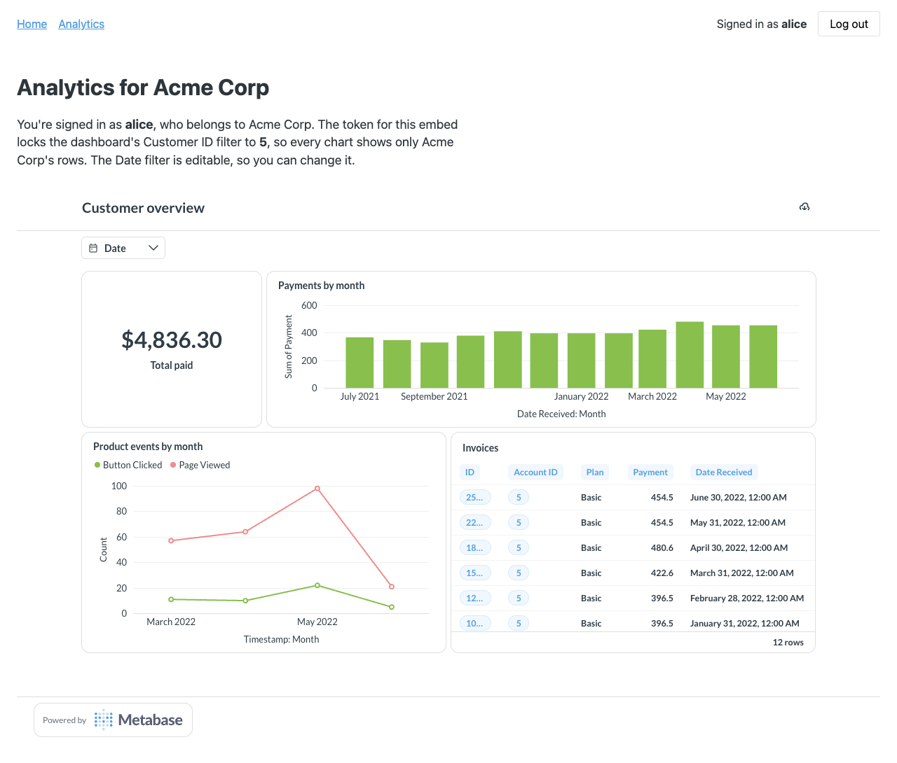

# Metabase guest embeds: reference web apps

This repo contains example applications for common web frameworks that show how to embed [Metabase](https://www.metabase.com/) dashboards in your application with [guest embeds](https://www.metabase.com/docs/latest/embedding/guest-embedding).

With a guest embed, your server signs a token, and your page passes the token to a Metabase component like `<metabase-dashboard>`. People who view the embed don't need a Metabase account. To show each of your customers only its own data, your server locks a filter to the customer's ID in the token.

> Looking for static embedding? It's [deprecated in favor of guest embeds](https://www.metabase.com/docs/latest/embedding/introduction#static-embedding-is-deprecated). Guest embeds use the same secret key and the same signed token, but they render a web component instead of an iframe.

If your customers need to explore data themselves, with drill-through, the query builder, or AI chat, check out [modular embedding with SSO](https://www.metabase.com/docs/latest/embedding/modular-embedding) or [full app embedding](https://www.metabase.com/docs/latest/embedding/full-app-embedding), and these resources:

- [Modular embedding demo](https://embedded-analytics-sdk-demo.metabase.com)
- [Modular embedding with SDK reference app](https://github.com/metabase/metabase-nodejs-react-sdk-embedding-sample)
- [Full app embedding quickstart](https://www.metabase.com/docs/latest/embedding/full-app-embedding-quick-start-guide)
- [Full app embedding demo](https://embedding-demo.metabase.com/)
- [Full app embedding reference app](https://github.com/metabase/sso-examples/tree/master/app-embed-example)

If you're unsure which way to embed is best for you, check out our [live demos](https://www.metabase.com/embedding-demo) and the [embedding introduction](https://www.metabase.com/docs/latest/embedding/introduction).

## About this repo

This README walks you through getting Metabase up and running, as well as a simple web app, to show you a live example of an embedded dashboard.

Here's a Metabase dashboard embedded in the Node app. The person who's signed in belongs to the customer Acme Corp, so the dashboard only shows Acme Corp's data:



## The apps

Each app does the same thing in a different framework: it shows one dashboard as a guest embed, and locks the dashboard to the customer of the person who's signed in. For comparison, each app's home page also shows a [public embed](#public-embeds).

| App                                              | Where the embedding code is                                                                                              |
| ------------------------------------------------ | ------------------------------------------------------------------------------------------------------------------------ |
| [Node](/node/README.md)                          | [index.js](/node/index.js)                                                                                               |
| [Django](/django/embedded_analytics/README.md)   | [user_stats/views.py](/django/embedded_analytics/user_stats/views.py)                                                    |
| [Rails](/rails/embedded_analytics/README.md)     | [app/controllers/analytics_controller.rb](/rails/embedded_analytics/app/controllers/analytics_controller.rb)             |
| [Laravel](/laravel/embedded_analytics/README.md) | [app/Http/Controllers/AnalyticsController.php](/laravel/embedded_analytics/app/Http/Controllers/AnalyticsController.php) |

If you're not sure which one to try, check out the [Node app](/node/README.md).

There are also minimal, single-file examples, without a login or customers:

- [Django](/django/minimal_example/index.py) and [Shiny](/shiny/minimal_example/app.R): a guest embed of the same dashboard, with the customer's ID set in the code.
- [HTML](/html/index.html): a [public embed](#public-embeds), which is a public link in an iframe, with no token.

## Guest embeds and the "Powered by Metabase" banner

Guest embeds are available on every Metabase plan. On the Open Source and Starter plans, guest embeds show a "Powered by Metabase" banner.

To remove the banner, upgrade to a [Pro or Enterprise plan](https://www.metabase.com/pricing/). On those plans, you can also [customize the colors and fonts](https://www.metabase.com/docs/latest/embedding/appearance) of your embeds and hide the download buttons. On the Open Source and Starter plans, you can pick a light or dark theme.

## Prerequisites

- Java, to run the Metabase JAR. See [Running the Metabase JAR file](https://www.metabase.com/docs/latest/installation-and-operation/running-the-metabase-jar-file) for the version that Metabase needs.

## Set up Metabase

We'll first need to set up a running instance of Metabase to serve the embedded dashboards. The `metabase` directory of this repo has an application database with the dashboards that the apps embed.

1. Shut down Metabase if you already have it running on your machine.
2. Download the [JAR file for Metabase OSS](https://www.metabase.com/start/oss/jar). The application database was last saved with Metabase 65, so use that version or a later one.
3. Open up a terminal and clone this repo to your machine.
4. Move the `metabase.jar` file from your downloads to the `static-embedding-reference-apps/metabase` directory.
5. `cd` into `static-embedding-reference-apps/metabase`.
6. Run the JAR file:
    ```
    java -jar metabase.jar
    ```
7. [Run any example](#running-the-apps) depending on the programming language you choose.

## Check that embedding is enabled

Once you've got Metabase running (on port 3000 by default):

1. Go to [`localhost:3000`](http://localhost:3000) in your browser.
2. Log into Metabase.
    - User: plucky@admin.com
    - Password: Metabase123
3. Click the **grid** icon in the upper right and select **Embedding hub**.
4. Go to **Security** and check that **Enable embedding** is on. On Pro and Enterprise plans, the toggle is called **Modular embedding**.

## What's in the demo Metabase

- **Customer overview** (dashboard 3): the dashboard that the apps embed. It's published as a guest embed. Its **Customer ID** filter is **Locked**, so the value has to come from the signed token, and its **Date** filter is **Editable**, so people can change it. The filter is connected to the Account ID column of the Sample Database's Invoices and Analytic Events tables.
- **A Public Dashboard** (dashboard 1) and **Number of Orders** (question 1): items with public links. The apps' home pages show both as public embeds, and the [HTML example](/html/index.html) embeds the question.
- **An Embedded Dashboard** (dashboard 2) and **Embeddable Number User Orders** (question 2): older items from when the apps used static embedding. The apps don't use them anymore.

To see how a guest embed is set up, open the **Customer overview** dashboard, click the **Share** icon, and select **Embed**.

## Running the apps

To see an embedded Metabase dashboard in action, [set up Metabase](#set-up-metabase), and follow the instructions in the README for one of [the apps](#the-apps).

## Embedding charts or dashboards

There are different ways to embed Metabase charts or dashboards in web applications.

### Public embeds

The [public embedding](https://www.metabase.com/docs/latest/embedding/public-links#public-embeds) method is to simply use the public URLs inside of an iframe, or really anywhere you can insert HTML. A public link only opens that one question or dashboard, so people can't use it to get to anything else in your Metabase. But public embeds don't involve any authentication, so anyone with the URL can view the data, and anyone can change the filters in the URL. Don't use public embeds to restrict data.

### Guest embeds

With [guest embeds](https://www.metabase.com/docs/latest/embedding/guest-embedding), your server signs a token with a secret key that it shares with your Metabase. Metabase only loads the embed if the token is valid.

To restrict the data in a guest embed, set a filter to [**Locked**](https://www.metabase.com/docs/latest/embedding/parameters#restrict-data-on-guest-embeds) and have your server put the value in the token. For example, the apps in this repo look up the customer of the signed-in user and lock the dashboard's Customer ID filter to that customer. You can lock a filter to anything your server knows about the viewer, like their organization, their account, or the user themselves. Metabase applies the filter before any data reaches the browser, and people can't change a locked value, because they don't have the secret key.

### Static embeds (deprecated)

[Static embedding](https://www.metabase.com/docs/latest/embedding/introduction#static-embedding-is-deprecated) puts the same signed token in an iframe URL, like `/embed/dashboard/YOUR_JWT_TOKEN`. Existing static embeds keep working, but use guest embeds for new work. The apps in this repo used static embedding before, and now use guest embeds.

### Modular embedding with SSO, and full app embedding

On Pro and Enterprise plans, your customers' users can sign in to Metabase with SSO. Metabase then knows who's viewing, so permissions restrict the data, and you can offer drill-through, the query builder, and more. To keep each customer's data separate, see [tenants](https://www.metabase.com/docs/latest/embedding/tenants). These kinds of embedding aren't covered in this repo.

## Docs and articles

- [Embedding introduction](https://www.metabase.com/docs/latest/embedding/introduction)
- [Guest embeds](https://www.metabase.com/docs/latest/embedding/guest-embedding)
- [Embedding parameters](https://www.metabase.com/docs/latest/embedding/parameters)
- [Securing embedded Metabase](https://www.metabase.com/docs/latest/embedding/securing-embeds)
- [Tenants](https://www.metabase.com/docs/latest/embedding/tenants)
- [Public links and embeds](https://www.metabase.com/docs/latest/embedding/public-links)

## Run into trouble?

Check out the [Metabase discussion forum](https://discourse.metabase.com/) and search for your issue. If you don't find any answers, please [create an issue](https://github.com/metabase/static-embedding-reference-apps/issues/new/choose) for this repository.
